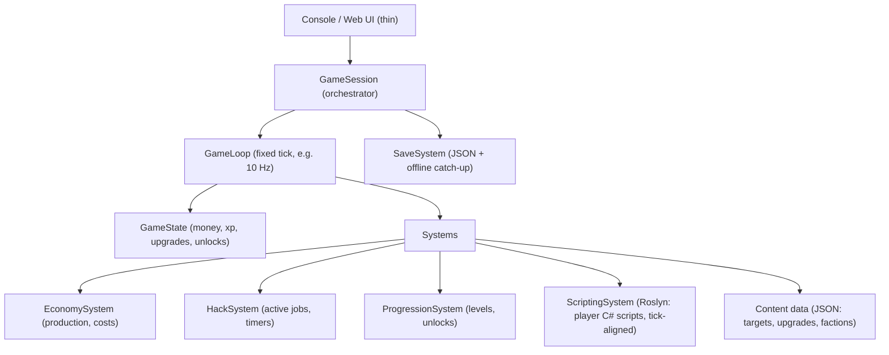

# NULLBYTE — C# Incremental Hacker Game

A Bitburner-inspired incremental/programming game in C#. Start tiny (a working
idle hacker in a console), then expand toward a scripting-driven game.

## 1. Design Pillars

- **Numbers go up, but choices matter.** Every purchase should be a tradeoff between money-per-second, upgrades, and unlocking new mechanics.
- **Automation is the content.** Early game is manual clicking; mid game is buying automation; late game is the player *programming* automation (the Bitburner hook).
- **Offline progress.** Incremental players expect progress while away — bake it in from the start.
- **Moddable content.** All game content (targets, upgrades, factions) should live in data files, not hardcoded, so adding content never requires touching the engine.

## 2. Core Loop (MVP)

1. Player runs **hacks** against a target → earns **money ($)** and **XP**.
2. Money buys **rig upgrades** (CPU, RAM, network) → faster hacks / passive income.
3. XP raises **skill level** → unlocks harder targets with better payouts.
4. Harder targets require better rig → feedback loop.

Currency list (keep it to one main currency for the MVP):
- **$ (money)** — universal.
- **XP/level** — progression gate.

Later currencies (Roadmap): **reputation** (factions), **research points** (tree), **crypto tokens** (prestige).

## 3. MVP Feature Set ("super simple")

| Feature | Description |
| --- | --- |
| Manual hack | Command/keypress that takes N seconds, yields $ based on target + rig |
| 5 targets | E.g. `webmail.zzz` → `bank-of-zzz`, escalating payout/requirements |
| Rig upgrades | 3–4 upgrade tracks (CPU: speed, RAM: concurrency, Net: offline efficiency) |
| Passive income | Hired bots / botnet that generate $/sec |
| Save/Load | JSON save file with offline progress on load |
| Console UI | Text commands + status bar; no graphics |

**Success criteria:** you can play 30 minutes, buy everything, and reset with offline earnings — all in a few hundred lines of C#.

## 4. Architecture

### Tech stack

| Layer | Choice | Why |
| --- | --- | --- |
| Language | C# / .NET 8 | As requested |
| Core engine | Plain class library (`Game.Core`) | No UI dependency; testable |
| MVP UI | Console (`Spectre.Console` optional) | Zero friction, iterate fast |
| Later UI | Blazor (web) or Avalonia (desktop) | Engine is UI-agnostic, so swap later |
| Scripting | Roslyn C# scripting (`Microsoft.CodeAnalysis.CSharp.Scripting`) — full C#, cooperative tick-aligned async/await model | The Bitburner-style hook; real language + IDE-grade editor (AvalonEdit + Roslyn classification) |
| Editor | AvalonEdit + Roslyn classification/IntelliSense | In-game script editor with real C# highlighting and completions |
| Save format | JSON via `System.Text.Json`, versioned | Easy debugging and migrations |
| Testing | xUnit on the engine | Incremental math is easy to unit test |

### Layer diagram



### Key design rules

1. **Deterministic fixed-tick simulation.** All game logic advances in discrete ticks (e.g. 100 ms). The UI never mutates state; it sends *commands* (`BuyUpgrade`, `StartHack`). This makes offline progress trivial: on load, fast-forward `elapsedTicks = Δtime / tickDuration`.
   - Use `double` for currency (incremental numbers get big; switch to a custom BigNum if exponents exceed ~1e15).
2. **Command pattern.** UI → `GameSession.Execute(ICommand)` → engine applies and emits events. Keeps UI replaceable (console today, Blazor tomorrow).
3. **Content as data.** `Target`, `Upgrade`, and later `Faction`/`Augmentation` are records defined in JSON, loaded into registries. Adding content = editing JSON.
4. **Exponential cost curve.** `cost = baseCost * growthRate^owned` (growthRate ≈ 1.07–1.15 per level, like classic idlers). Production scales linearly per level → exponential cost creates the classic "wall then breakthrough" pacing.
5. **Save migrations.** Include a `schemaVersion` int in the save; write a migration step per version bump.
6. **Scripts save as source + explicit state.** Roslyn continuations cannot be serialized. Persist each script's source text + its `ns.Data` key-value store; on load, recompile and restart — scripts reconverge because they're loops. Durable facts go in `ns.Data`, ephemeral progress lives in locals and is accepted lost. Make spendy commands idempotent ("if already owned, no-op") so restarts can't double-buy.

### Suggested project layout

```
Nullbyte.sln
├─ src/Nullbyte.Core/           # engine, no I/O except SaveSystem
│  ├─ GameSession.cs            # command entry point
│  ├─ GameLoop.cs               # fixed tick loop
│  ├─ GameState.cs              # pure state record
│  ├─ Systems/
│  │  ├─ EconomySystem.cs
│  │  ├─ HackSystem.cs
│  │  └─ ProgressionSystem.cs
│  ├─ Content/
│  │  ├─ ContentLoader.cs
│  │  ├─ Target.cs / Upgrade.cs
│  │  └─ data/*.json
│  ├─ Commands/                 # ICommand implementations
│  └─ Save/SaveSystem.cs
├─ src/Nullbyte.Console/        # MVP frontend
├─ src/Nullbyte.Scripting/      # (Phase 4) Roslyn runtime: ns API, tick barrier, quota, lockdown
├─ src/Nullbyte.Editor/         # (Phase 4) AvalonEdit + Roslyn classification frontend
└─ tests/Nullbyte.Core.Tests/
```

## 5. Roadmap

### Phase 1 — Playable core (1–2 weeks of spare time)
- Fixed-tick engine, manual hack with timer, money + XP
- 5 targets, 3 upgrade tracks with exponential costs
- Passive botnet income
- JSON save/load + offline catch-up
- Console UI: `hack <target>`, `buy <upgrade>`, `status`, `save`
- *Exit test:* a full playthrough loop feels satisfying for 30 min.

### Phase 2 — Progression & content depth
- 15–20 targets with "security levels" (some require meeting rig thresholds)
- Skill tree: spend XP on perks (hack speed, batch hacking, offline %)
- Event log / terminal flavor text (hacker theme sells the fantasy)
- Achievements and stats page
- Missions/contracts (timed objectives with rewards) — first "content drip"
- *Exit test:* returning after a day feels rewarding.

### Phase 3 — prestige
- Prestige/reset layer ("burn your identity"): reset for permanent multipliers
- Second currency, exponential-tier prestige upgrades
- More content data + a content validator tool so balance mistakes surface early
- *Exit test:* a first reset is an exciting choice, not a chore.

### Phase 4 — The programming hook (Bitburner moment)
- **Roslyn C# scripting as the player language** (full C#, async/await, LINQ) — validated by spike: `ns` API object, tick barrier (`TaskCompletionSource` released once per tick), per-script CPU quota, compile-time lockdown (whitelisted namespaces/usings, banned patterns fail compilation)
- Execution model: scripts are `async Task` coroutines; every `await` on an `ns` promise is tick-aligned — scripts cannot proceed between ticks
- CPU economy: time-based quota per script per tick, scaled by rig CPU/RAM → rig upgrades make scripts "faster" (API-call metering for cost balance)
- Save model: persist script source + `ns.Data` key-value state; recompile and restart on load; durable facts in `ns.Data`, locals accepted lost; spendy commands made idempotent
- In-game editor: AvalonEdit + Roslyn classification → real C# highlighting, IntelliSense, compile-error squiggles
- Script marketplace (share/import scripts as JSON strings)
- Runtime errors halt one script, never the game; cache compiled scripts per save (Roslyn warm-up ~1–2 s once)
- *Exit test:* a player script can play the early game unattended; save/load round-trips and the script reconverges.

### Phase 5 - Factions 
- Factions with reputation grind → unique upgrades (Bitburner staple)
- *Exit test:* Exploring factions is rewarding game play wise

### Phase 6 — World & late game
- Persistent "network map" world (nodes to conquer, turf mechanics)
- Multiplayer-adjacent features (leaderboards via exported saves, weekly challenges)
- Blazor/Avalonia UI with a real terminal window and live graphs
- Move constants to the content to enable easier balancing
- Balancing pass, difficulty curve tuning from telemetry-style save data

## 6. First Week Checklist

- [x] `dotnet new` solution with Core + Console projects
- [x] GameState record + fixed-tick GameLoop running in a test
- [x] Manual hack command with income math + exponential upgrade costs
- [x] JSON content file for targets/upgrades + loader
- [x] Save/load with `schemaVersion` and offline catch-up
- [x] Minimal console commands: `hack`, `buy`, `status`
- [x] Unit tests: cost curve, offline catch-up, save round-trip

## 7. Pitfalls to avoid

- **No fixed tick / state mutated from UI threads** → nondeterministic offline progress and unfixable bugs later.
- **Hardcoded content** → every balance tweak is a recompile.
- `float`/`decimal` money → precision issues; use `double` then BigNum.
- **Building the scripting layer too early** → nail the idle core first; scripting needs solid, tick-based systems underneath it.
- **Trusting Roslyn as a sandbox** → .NET has no true sandbox; enforce at compile time (reference/using whitelist, banned-pattern analyzer) and treat scripts as player-self-inflicted risk, like Bitburner does. Real isolation would require an out-of-process host.
- **Expecting to serialize running scripts** → Roslyn continuations can't be saved; design `ns` APIs and player conventions around source-restart + `ns.Data` from day one.
- **Scope creep before Phase 1 exit test** — resist UI polish and factions until the core loop is fun.